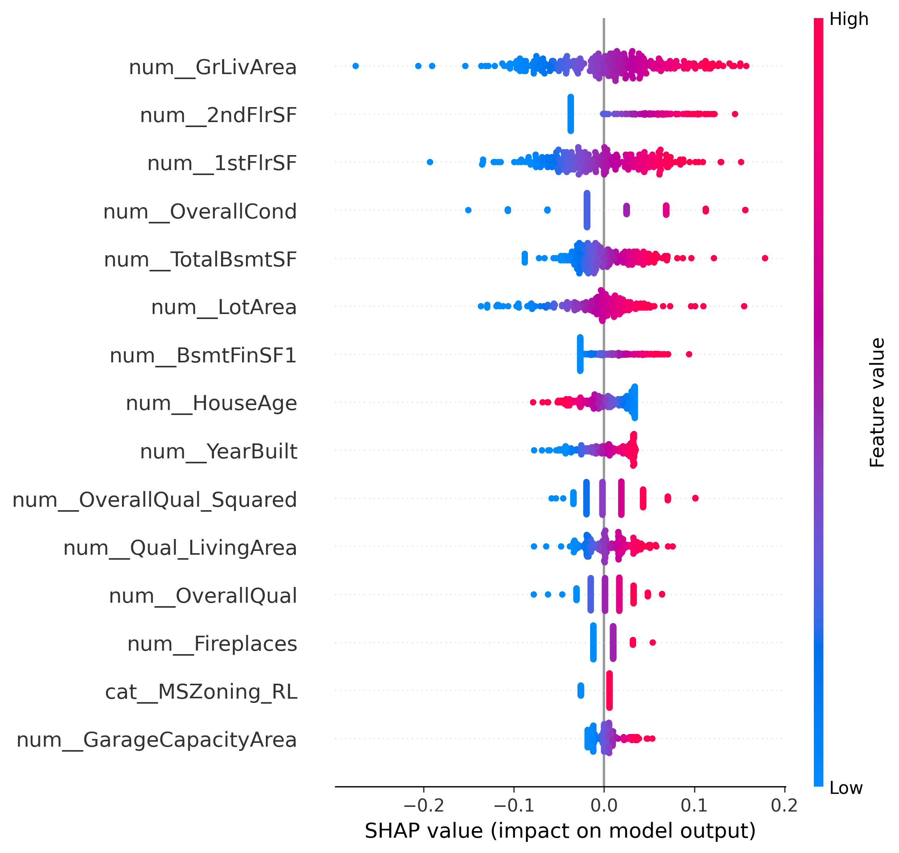
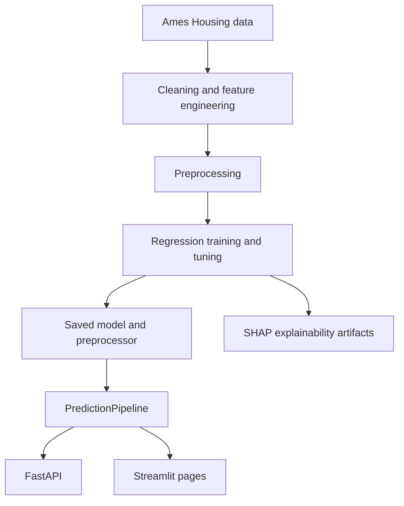
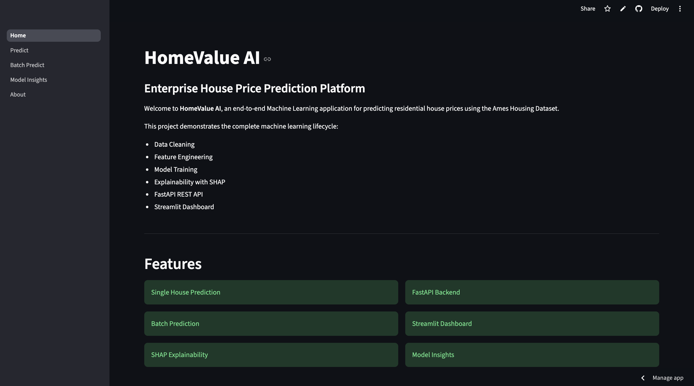

# HomeValue-AI

HomeValue-AI is an end-to-end residential property price prediction project built around the Ames Housing dataset. It includes data preparation, feature engineering, regression model comparison, hyperparameter tuning, SHAP explainability, saved model artifacts, a FastAPI prediction API, and a multi-page Streamlit interface.

## Objective

Estimate residential sale prices from property attributes and make predictions available for individual properties and batches of property records.

## Implemented Components

- Data cleaning and feature engineering modules
- Numeric and categorical preprocessing
- Regression model training and hyperparameter tuning
- Saved preprocessing and model artifacts
- SHAP explainability outputs
- Prediction pipeline that reuses training-time feature handling
- FastAPI endpoints for health checks, single predictions, and batch predictions
- Streamlit pages for prediction, batch prediction, model insights, and project information

## Dataset

- **Dataset:** Ames Housing
- **Target:** `SalePrice`
- **Task:** Regression
- **Source data:** `data/raw/train.csv` and `data/raw/test.csv`
- **Prepared data:** `data/processed/`

## Model Evaluation Results

The committed model-comparison artifact is [artifacts/comparision.csv](artifacts/comparision.csv). It contains these saved regression results:

| Model | MAE | RMSE | R² | Mean CV RMSE | CV RMSE std |
|---|---:|---:|---:|---:|---:|
| Ridge Regression | 0.0810 | **0.1180** | **0.9174** | **0.1144** | 0.0071 |
| Linear Regression | 0.0843 | 0.1289 | 0.9015 | 0.1160 | **0.0066** |
| Gradient Boosting Regression | 0.0870 | 0.1255 | 0.9066 | 0.1289 | 0.0087 |
| Random Forest Regression | 0.0969 | 0.1420 | 0.8804 | 0.1415 | 0.0137 |
| XGBoost Regression | 0.0959 | 0.1375 | 0.8878 | 0.1418 | 0.0122 |
| Decision Tree Regression | 0.1555 | 0.2069 | 0.7461 | 0.2042 | 0.0135 |
| Lasso Regression | 0.3246 | 0.4106 | -0.0001 | 0.3971 | 0.0184 |

**Saved comparison finding:** Ridge Regression has the lowest listed test RMSE (0.1180) and highest listed R² (0.9174) among the candidate models. Linear Regression has the lowest cross-validation RMSE standard deviation (0.0066), while Ridge has the lowest mean cross-validation RMSE (0.1144).

The values in this committed CSV differ slightly from an earlier headline summary in project notes (MAE 0.0784, RMSE 0.1160, R² 0.9202). The comparison CSV is the directly committed, inspectable result table and is used as the primary reference here. The discrepancy should be reconciled before publishing a single definitive metric set.

The error values appear to be on a transformed target scale: the prediction pipeline applies an inverse exponential transformation after prediction. They should not be interpreted as dollar-denominated errors. Confirm the split and metric calculation in the training notebook before comparing the scores with other property-price projects.

### Saved explainability artifacts

The repository includes Ridge coefficients and SHAP outputs, including global summary, beeswarm, bar, decision, and local waterfall plots under the artifacts directory. The coefficient values belong to the transformed/scaled feature space and are not direct dollar effects.



## Architecture



## API

The FastAPI application is created in `api/main.py` and includes routes from `api/routes.py`.

| Method | Endpoint | Purpose |
|---|---|---|
| GET | `/` | API welcome message |
| GET | `/health` | Health response |
| POST | `/predict` | Predict one property |
| POST | `/batch_predict` | Predict multiple properties |

The request schemas are defined in `api/schemas.py`. Interactive API documentation is available at `http://127.0.0.1:8000/docs` when the API is running.

Run the API from the repository root:

```bash
uvicorn api.main:app --reload
```

## Streamlit Application

The implemented Streamlit landing page is `app/1_Home.py`; other pages cover single prediction, batch prediction, model insights, and project information.

```bash
streamlit run app/1_Home.py
```

The root-level `app.py` is empty in the current repository snapshot and is not the Streamlit entry point.

## Repository Structure

```text
.
├── api/                 # FastAPI application, routes, schemas, utilities
├── app/                 # Streamlit home page, prediction pages and components
├── artifacts/           # preprocessing, feature schema, model comparison and SHAP outputs
├── data/
│   ├── raw/             # Ames Housing source files and data description
│   └── processed/       # cleaned and feature-engineered datasets
├── images/              # application screenshots
├── models/              # saved estimator
├── notebooks/           # EDA, cleaning, feature engineering, training and SHAP
├── src/
│   ├── data/
│   ├── features/
│   ├── models/
│   ├── pipelines/
│   ├── preprocessing/
│   ├── utils/
│   └── visualization/
├── predict.py
├── train.py
├── app.py               # empty placeholder
├── requirements.txt
├── runtime.txt
└── README.md
```

## Local Setup

```bash
git clone https://github.com/saidattaputta/HomeValue-AI.git
cd HomeValue-AI
python -m venv .venv
source .venv/bin/activate  # Windows: .venv\\Scripts\\activate
pip install -r requirements.txt
```

The training script expects prepared data at `data/processed/train_features.csv` and writes model/preprocessing/explainability artifacts. Review those configured paths before running it because the training workflow can overwrite generated artifacts.

```bash
python train.py
```

The prediction utility reads the source training CSV and uses the saved pipeline:

```bash
python predict.py
```

Both commands require the corresponding datasets and saved artifacts to exist.

## Visuals

The repository includes Streamlit screenshots under `images/`, including the home, prediction, batch prediction, and model-insights views.



## Technology

Python, pandas, NumPy, scikit-learn, SHAP, Matplotlib, joblib, FastAPI, Uvicorn, Pydantic, and Streamlit.

## Limitations and Validation Notes

- Reported MAE/RMSE values appear to be on a transformed target scale rather than the original currency scale.
- The repository does not contain a dedicated automated test suite.
- The root `app.py` is empty; use `app/1_Home.py` to launch the Streamlit interface.
- The prediction pipeline depends on the committed preprocessor/model/frequency artifacts and the expected input feature schema.
- The training and prediction scripts were inspected but not executed in this review.
- SHAP explanations describe model behavior and do not establish causal effects of property attributes.

## Future Improvements

Add automated tests for preprocessing and inference, document metric units and split details, validate batch input schemas, and add model monitoring and reproducibility metadata.

---

**Sai Datta Putta**

[LinkedIn](https://www.linkedin.com/in/sai-datta-putta/)
